# Enterprise Linux Infrastructure

## What I Built
I built two Linux servers in VirtualBox that work like a small company's servers: Rocky Linux 10.2 and Ubuntu Server 26.04 LTS. Rocky runs user accounts with limited sudo, key-only SSH, expandable LVM storage, an NFS shared folder, a DNS server, and nightly backups, with SELinux and the firewall on the whole time. Ubuntu mounts the shared folder and uses Rocky's DNS.

## Tools Used
- VirtualBox (NAT + host-only networking)
- Rocky Linux 10.2, Ubuntu Server 26.04.1 LTS
- LVM, XFS
- NFS (nfs-utils, nfs-common)
- dnsmasq, dig
- systemd timers, Bash, tar
- SELinux, firewalld
- OpenSSH

## How It Works
```text
Mac (host)
 |-- rocky VM (192.168.56.10)
 |     |-- users/groups: it, sales; limited sudo for "it"
 |     |-- SSH: keys only, no root login (Mac port 2223)
 |     |-- LVM: sdb -> datavg -> datalv (/data), grown live to 2 GB
 |     |-- NFS export: /data/shared (group "it" only)
 |     |-- dnsmasq: rocky.lab.local, ubuntu.lab.local
 |     |-- nightly backup of /data/shared (systemd timer, 02:00)
 |     |-- SELinux enforcing + firewalld
 |-- ubuntu VM (192.168.56.11)
       |-- mounts rocky:/data/shared at /mnt/shared (fstab)
       |-- asks rocky for DNS
```

## Steps
1. Created groups `it` and `sales` and users `alice` and `bob`.
2. Gave the `it` group limited sudo (status and restart of sshd only) through `/etc/sudoers.d/`.
3. Switched SSH to keys only and disabled root login, testing with `sshd -t` first.
4. Added a second virtual disk, built LVM on it, and grew the volume live with `lvextend` and `xfs_growfs`.
5. Added a host-only network so the two VMs could reach each other.
6. Shared `/data/shared` over NFS (setgid, group `it`) and mounted it on Ubuntu through `/etc/fstab`.
7. Set up dnsmasq with forward and reverse records for both machines.
8. Wrote a Bash backup script, scheduled it with a systemd timer, and tested a restore.
9. Verified SELinux is enforcing and the firewall is running with only needed services.

## Screenshots

### P1-01 — Users, Groups, and Sudo Access
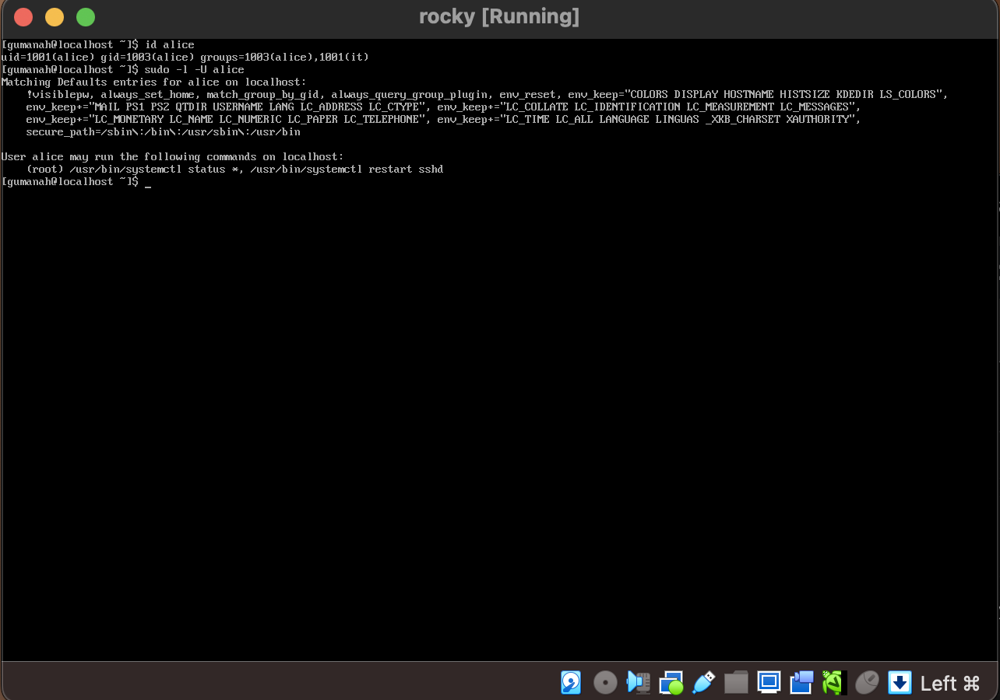
Shows alice in the `it` group with only two allowed sudo commands (least privilege).

### P1-02 — SSH Key-Only Login
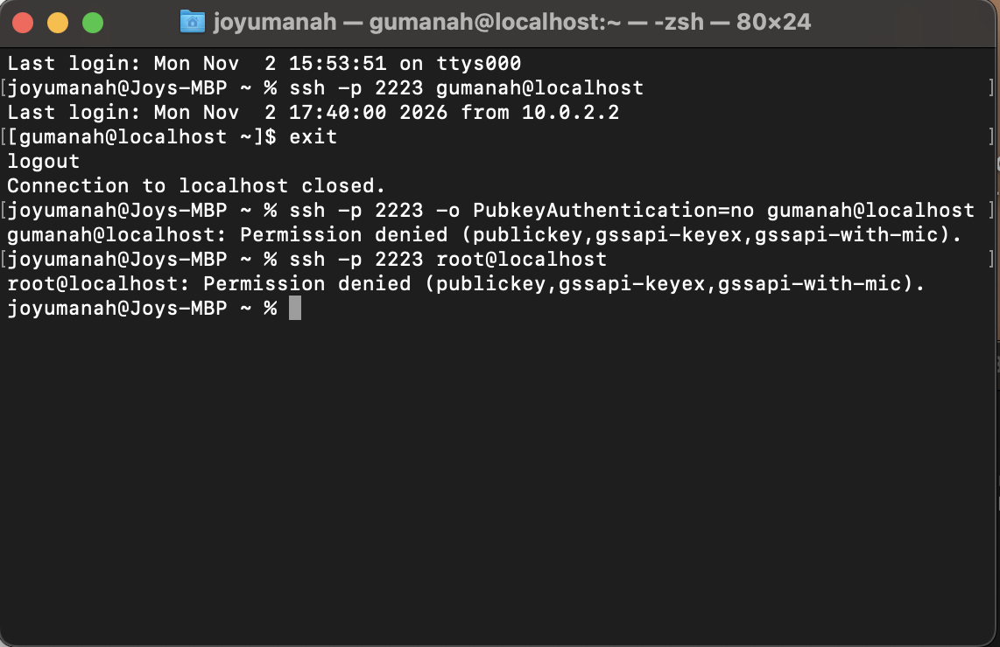
Shows key login working while password and root logins are refused.

### P1-03 — LVM Storage Expanded
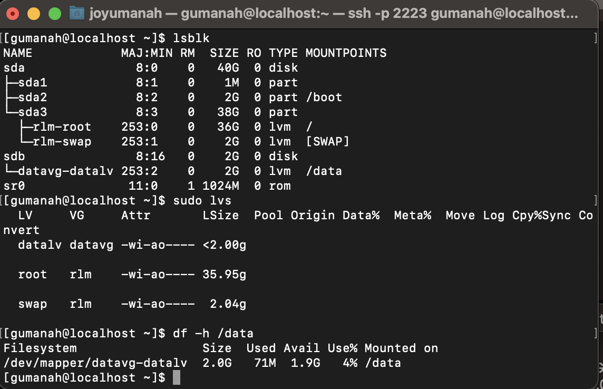
Shows the logical volume grown from 1 GB to 2 GB while mounted.

### P1-04 — NFS Shared Folder Mounted
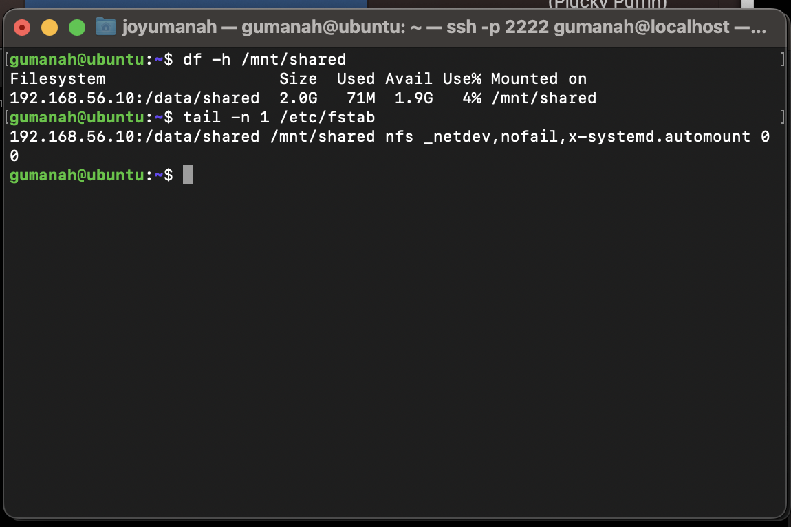
Shows Rocky's share mounted on Ubuntu and set to mount automatically through fstab.

### P1-05 — DNS Name Lookups Working
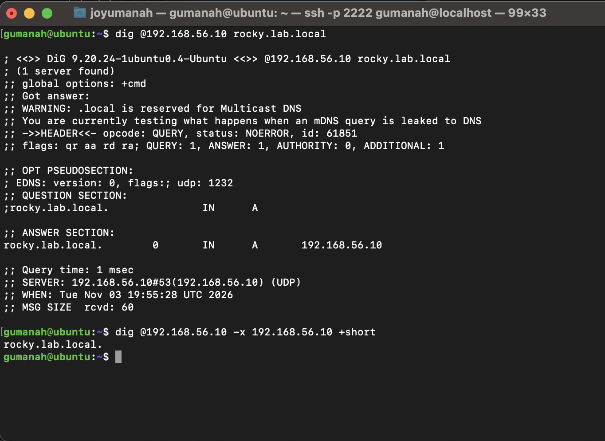
Shows forward and reverse lookups answered by Rocky's DNS server from Ubuntu.

### P1-06 — Automatic Backup and Restore
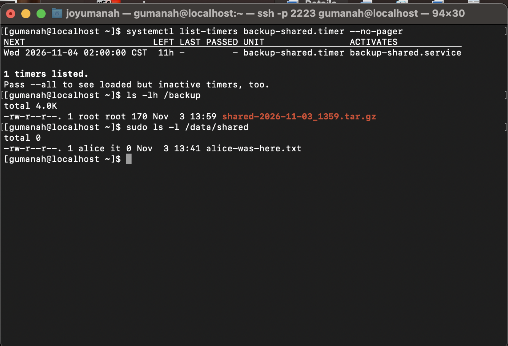
Shows the nightly timer, a backup file, and a deleted file restored from it.

### P1-07 — SELinux and Firewall Enabled
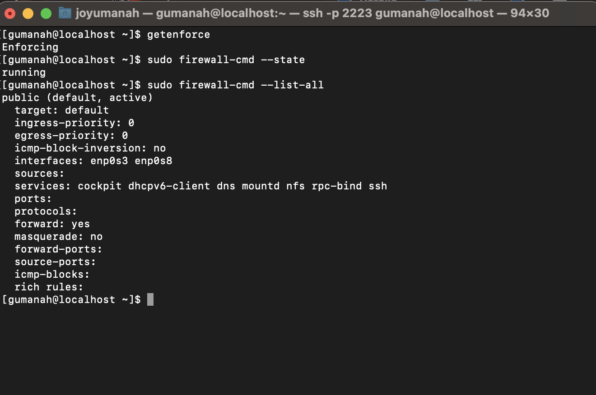
Shows SELinux enforcing and the firewall running with only needed services.

### P1-08 — Ticket: Shared Folder Access Denied (Broken)
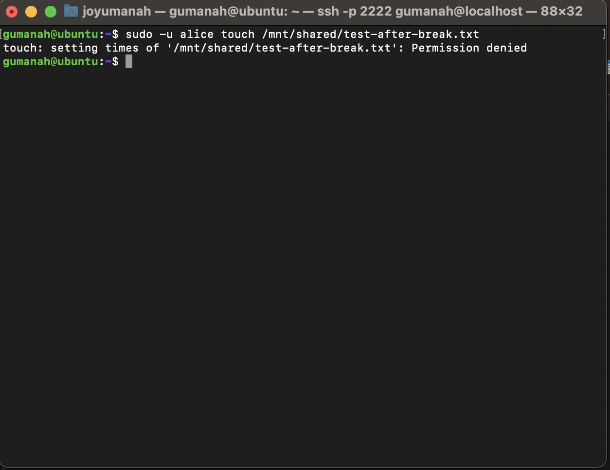
Shows the permission-denied error a group member got on the share.

### P1-09 — Ticket: Shared Folder Fixed
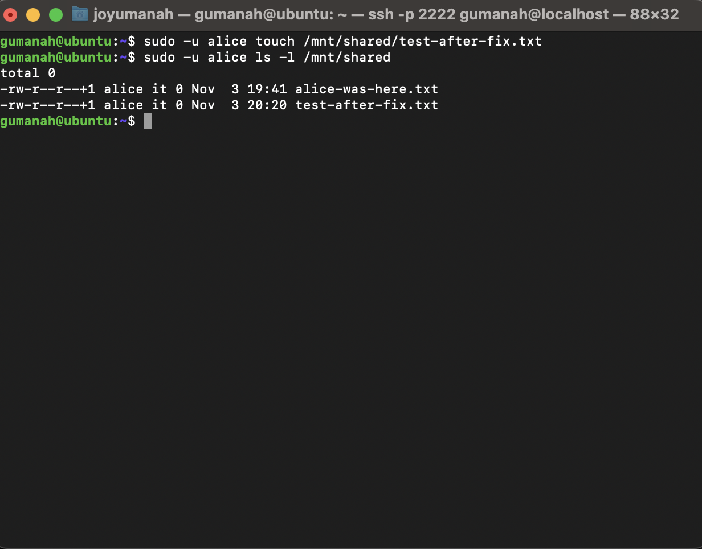
Shows the same user writing to the share after the fix.

### P1-10 — Ticket: SSH Failure Found in Logs
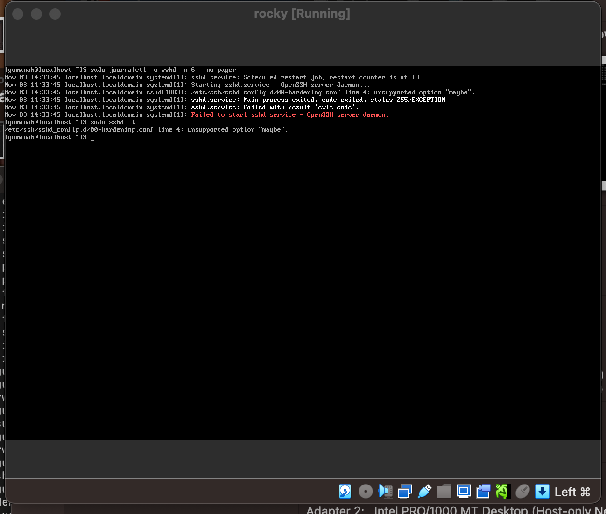
Shows `journalctl` and `sshd -t` naming the bad setting from the VM console.

### P1-10b — Ticket: SSH Fixed
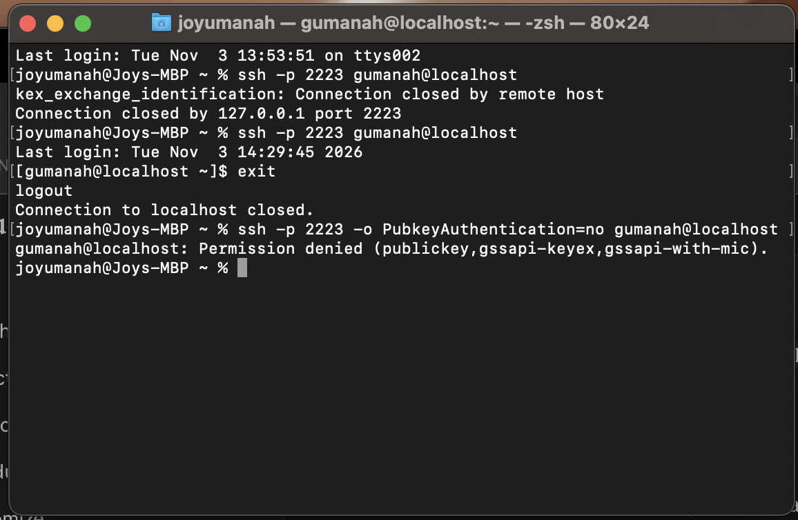
Shows sshd running again and key login working from the Mac.

## Troubleshooting Tickets

**Ticket 1: User can't open the shared folder**
- Found: `ls -ld /data/shared` showed `drwx--S---` instead of `drwxrws---`.
- Cause: permissions had been changed from 2770 to 700, locking out group `it`.
- Fix: `chmod 2770 /data/shared`; alice then created a file from Ubuntu.

**Ticket 2: SSH stopped working after a settings change**
- Found: from the VM console, `journalctl -u sshd` and `sshd -t` named `00-hardening.conf line 4: unsupported option "maybe"`.
- Cause: an invalid value for `PermitRootLogin`.
- Fix: removed the line, `sshd -t` passed, restarted sshd, and key login worked again.

## What I Learned
- Least privilege means giving a group only the commands its job needs.
- Always run `sshd -t` before restarting SSH, and keep a console open as a safety net.
- NFS matches users by number (UID/GID), not name, so IDs must line up across machines.
- LVM lets me grow storage live without downtime.
- A backup is only real once I have restored from it.
